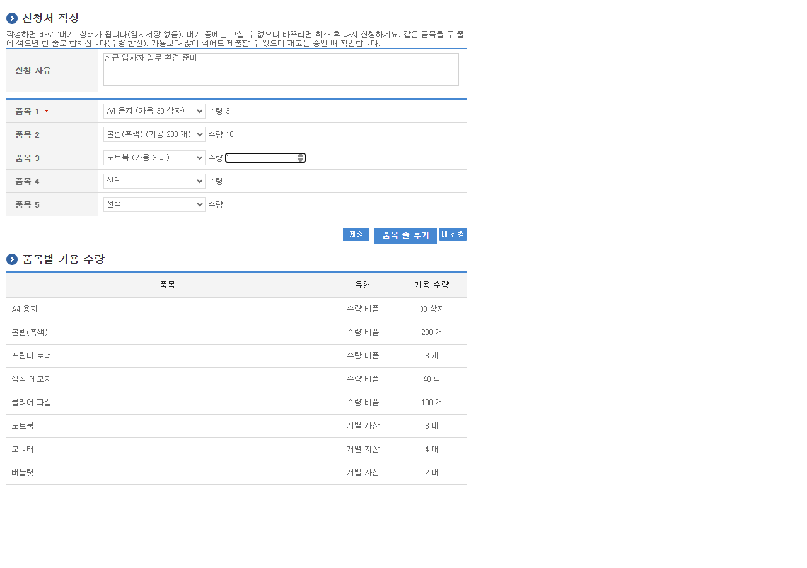
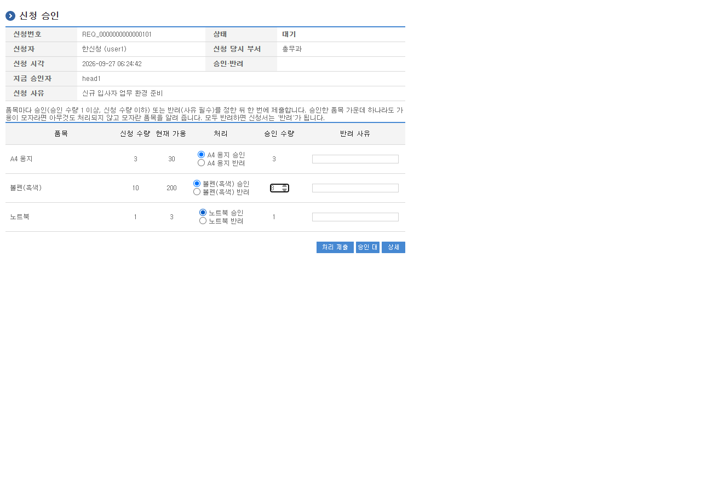
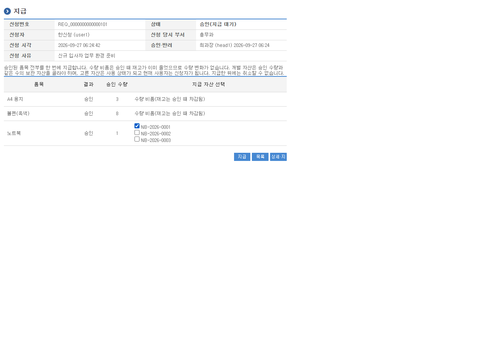
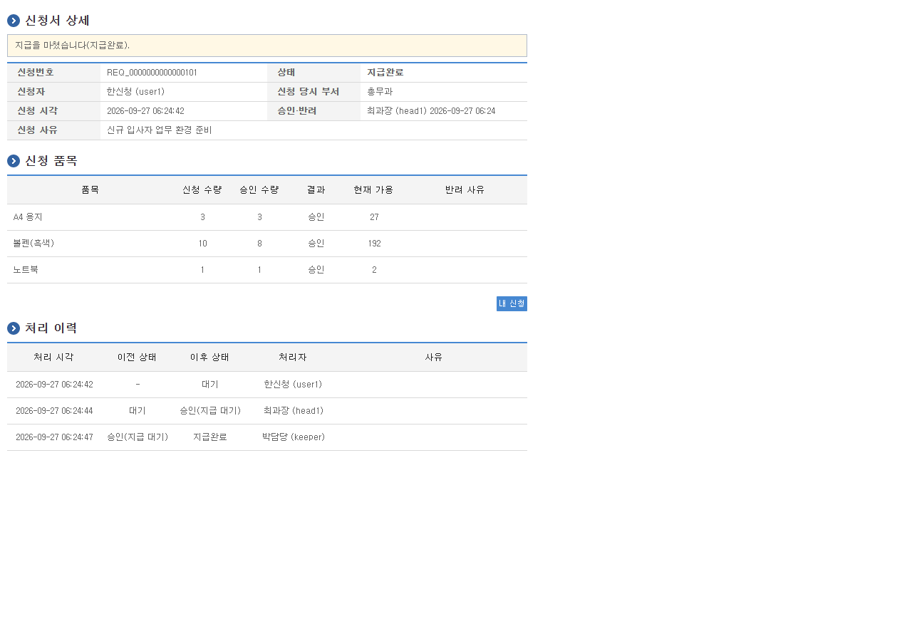

# 기관 비품·자산 관리 시스템

전자정부 표준프레임워크 **공통컴포넌트 5.0.6**(실행환경 5.0.x) 위에 만든 공공기관형 비품·자산 관리 업무 시스템입니다.
수량 비품과 개별 자산을 한 신청서로 받아 **신청 → 부서장 승인(품목별) → 자산담당자 지급**으로 처리하고,
입고·조정·반납·수리·폐기, 엑셀 일괄등록·내려받기, 야간 재고 부족 집계를 제공합니다.

> **개인 포트폴리오 프로젝트입니다.** 발주처가 없으며 경력이나 사업 실적이 아닙니다.
> 기관명·인물은 모두 가상입니다.

## 무엇을 보여 주는가

- **공통컴포넌트 재사용**: 로그인(Spring Security)·5회 실패 잠금, 권한·역할·URL 접근 제어, 포털 메뉴, 공통코드, 게시판(공지), 배치 결과 화면을 그대로 씁니다. 신청서 중복 제출 방지만은 공통컴포넌트 도우미(세션당 토큰 1개)로는 두 탭·실패 후 재전송을 풀 수 없어 화면별 토큰으로 바꿨습니다. 기반 소스 수정은 최소화하고 수정마다 커밋 메시지에 사유를 적었습니다.
- **표준 계층 규칙**: 컨트롤러 → 서비스 인터페이스 → `EgovAbstractServiceImpl` 구현 → `EgovAbstractMapper` DAO → MyBatis 매퍼. 목록은 `PaginationInfo`, 업무 키는 `EgovIdGnrService`. 규칙은 스크립트로 점검합니다(아래 점검표).
- **결재 흐름과 동시 처리의 정확성**: 재고·상태를 바꾸는 모든 처리는 `신청서 행 → 품목 행(품목코드 오름차순)` 순서로 잠근 뒤 다시 확인합니다. 승인과 일괄등록은 전부 반영하거나 전부 반영하지 않습니다. 모든 재고 변동·자산 상태 변경·신청 상태 변경은 이력으로 남습니다.

## 기술 스택

| 구분 | 내용 |
|---|---|
| 기반 | 전자정부 표준프레임워크 공통컴포넌트 v5.0.6 (parent `egovframe-web-config-parent`, Spring 6.2.x) |
| 언어·빌드 | Java 17, Maven (Docker `maven:3.9-eclipse-temurin-17`) |
| 화면 | JSP + JSTL + jQuery (공통컴포넌트 화면 틀과 스타일) |
| 데이터 | MyBatis, MySQL 8.0 (서버 collation 옵션 없음) |
| WAS | Tomcat 10.1 (Jakarta) |
| 실행 | Docker Compose (`mysql:8.0` + `tomcat:10.1-jdk17`) |

## 실행 방법

로컬에 JDK·Maven이 없어도 됩니다. Docker만 있으면 됩니다.

1. `.env` 만들기: `.env.example`을 복사해 `.env`로 저장하고 값을 채웁니다(DB 계정·암호, MySQL 루트 암호, Crypto 키, 데모 비밀번호). `.env`는 저장소에 올라가지 않습니다.
2. WAR 빌드(처음에는 의존성 내려받기 때문에 오래 걸립니다):
   ```bash
   bash scripts/build.sh
   ```
   WAR를 먼저 만들어야 합니다. WAR가 없는 상태로 `docker compose up`을 하면 Docker가 그 경로에 빈 폴더를 만듭니다.
3. 기동:
   ```bash
   docker compose up -d
   ```
   앱 컨테이너가 켜질 때 `.env` 값으로 설정 파일(Crypto 키와 짝 해시, 새 키로 암호화한 DB 암호)을 만들고, 처음 기동할 때 한 번만 시드 계정 비밀번호를 데모 비밀번호로 설정합니다. 필수 값이 비어 있으면 기동을 멈추고 무엇을 넣어야 하는지 로그에 알려 줍니다.
4. 접속: `http://localhost:8080/uat/uia/egovLoginUsr.do` → **업무사용자** 탭에서 로그인 → 상단의 포털 메인(`/sym/mnu/mpm/EgovMainMenuHome.do`)에서 역할별 메뉴를 씁니다.
5. 초기화: `docker compose down -v`(DB 볼륨까지 지움)

> 로그인 쿠키에 Secure 속성이 붙습니다. `localhost`는 브라우저가 예외로 처리하므로 로컬에서는 문제없지만, 다른 서버에 평문 HTTP로 배포하면 로그인이 유지되지 않습니다(HTTPS 필요).

## 데모 계정

비밀번호는 모두 `.env`의 `DEMO_PASSWORD`입니다(문서에는 적지 않습니다).

| 아이디 | 역할 | 부서 | 비고 |
|---|---|---|---|
| `admin1`, `admin2` | 관리자 | 총무과, 정보화팀 | 서로의 신청을 승인할 수 있도록 2명 |
| `keeper` | 자산담당자 | 총무과 | 입고·지급·자산 관리·엑셀·집계 |
| `head1` | 신청자(총무과 부서장) | 총무과 | |
| `head2` | 신청자(정보화팀 부서장) | 정보화팀 | |
| `user1`~`user4` | 신청자 | 총무과, 정보화팀, 민원실 ×2 | 민원실은 부서장이 없어 관리자가 대신 승인 |

공통컴포넌트 DML에 원래 들어 있는 기본 계정 4개(`TEST1`, `webmaster`, `USER`, `ENTERPRISE`)는 공개된 기본 비밀번호가 있으므로 **로그인할 수 없게 비활성화**했습니다(잠금 + 권한 제거 + 쓸 수 없는 암호 값).

## 기능과 흐름

| 역할 | 메뉴 | 할 수 있는 일 |
|---|---|---|
| 모두 | 비품 신청 | 신청서 작성(여러 품목, 같은 품목은 합산, 가용 수량 표시·초과 시 경고), 내 신청 조회·대기 중 취소, 승인 대기함, 부서 신청 조회(부서장), 공지사항 |
| 자산담당자 | 재고·자산 관리 | 품목 관리(등록·수정·사용 중지·삭제), 입고·조정, 재고 이력, 개별 자산(등록=입고, 반납·수리·수리 완료·폐기), 지급·지급취소, 엑셀, 재고 부족 집계, 배치 결과 |
| 관리자 | 관리 | 부서장 지정·해제(무효 지정 표시), 전체 신청 조회, 업무사용자·부서·권한 관리(공통컴포넌트) |

- **승인자 결정**: 신청 당시 부서를 저장하고, 승인자는 조회·승인하는 시점에 정합니다. 그 부서에 지금 유효한 부서장(그 부서 소속이고 로그인 가능한 계정)이 있고 신청자가 아니면 부서장, 아니면 신청자가 아닌 관리자입니다. 승인할 사람이 없으면 제출을 막습니다. **어떤 경로로도 자기 신청은 승인할 수 없습니다**(서비스 계층에서 차단).
- **승인**: 한 화면에서 품목마다 승인 수량(1~신청 수량) 또는 반려+사유를 정해 한 번에 제출합니다. 승인 품목 중 하나라도 가용이 모자라면 아무것도 바뀌지 않고, 모자란 품목과 수량을 모두 보여 줍니다. 통과하면 재고가 확보됩니다(수량 비품은 재고 차감, 개별 자산은 확보 수량 증가).
- **지급**: 신청서 단위로 한 번에 처리하며, 개별 자산은 승인 수량만큼 보관 자산 번호를 정확히 골라야 합니다. 지급취소는 사유를 받고 확보분을 되돌립니다.
- **가용 수량**: 수량 비품 = 재고 수량, 개별 자산 = 보관 자산 수 − 확보 수량. 0 미만이 되는 처리는 모두 거부합니다.
- **엑셀**: 품목 일괄등록(재고 0으로 시작), 자산 일괄등록(줄마다 입고). 한 줄이라도 틀리면 아무것도 저장하지 않고 틀린 줄 번호와 이유를 목록으로 보여 줍니다. 내려받기 3종(재고 현황, 자산 대장, 기간별 신청 내역).
- **야간 재고 부족 집계**: 매일 02:00(Asia/Seoul) 앱 내부 스케줄러가 `가용 < 최소 수량`인 사용 중 품목을 집계하고, 담당자는 화면에서 즉시 실행할 수 있습니다. 실행 결과는 공통컴포넌트 배치 결과 화면에도 남습니다.

## 화면

`docs/screenshots/`에 실제 기동 화면을 캡처했습니다(신청 → 승인 → 지급 1회).

| | |
|---|---|
|  |  |
| 신청서 작성(가용 수량 표시) | 부서장 품목별 승인(수량 축소) |
|  |  |
| 지급(개별 자산 번호 선택) | 지급 완료 신청서와 처리 이력 |

## 구조 규칙 점검표

`bash scripts/check-rules.sh`로 점검합니다(업무 패키지 `egovframework.asset` 대상).

| 규칙 | 점검 방법 | 결과 |
|---|---|---|
| 1. 서비스 구현은 `EgovAbstractServiceImpl` 상속 + 서비스 인터페이스 구현 | 모든 `*ServiceImpl` 8개 검사 | 위반 0 |
| 2. DAO는 `EgovAbstractMapper` 상속, SQL은 MyBatis 매퍼 XML에만 | 모든 `*DAO` 8개, 자바 안 SQL 문자열·JDBC 직접 사용 검색 | 위반 0 |
| 3. 컨트롤러에는 서비스 인터페이스만 주입 | `@Controller` 7개의 DAO·구현 클래스 import·필드 검사 | 위반 0 |
| 4. 목록 페이징 `PaginationInfo`, 업무 키 `EgovIdGnrService` | 사용처 집계 | 6개 파일, 5개 파일 |
| 5. 실행환경 jar와 Spring 버전은 parent BOM을 따름 | pom에서 실행환경·Spring 버전을 재정의하지 않음 | 준수 |

```text
[규칙 1] 서비스 구현은 EgovAbstractServiceImpl 상속 + 서비스 인터페이스 구현
  대상 8개
[규칙 2] DAO는 EgovAbstractMapper 상속, SQL은 MyBatis 매퍼 XML에만
  대상 8개
  매퍼 XML 8개
[규칙 3] 컨트롤러에는 서비스 인터페이스만 주입(DAO·구현 클래스 참조 금지)
  대상 7개
[참고] 규칙 4 사용처: PaginationInfo 6개 파일, EgovIdGnrService 5개 파일
위반 합계: 0건
```

## 테스트

실제 MySQL 8.0 컨테이너(기본 collation, 공통컴포넌트 DDL·DML + 업무 스키마·시드)를 띄워 업무 패키지 통합 테스트만 실행합니다. 실행된 테스트가 0건이면 실패로 봅니다.

```bash
bash scripts/verify.sh
```

업무 통합 테스트 105건(11개 클래스). 주요 시나리오:

- 여러 품목 신청 → 품목별 승인(수량 축소 + 반려) → 지급 → 재고·이력 확인
- 개별 자산 신청 → 승인(확보) → 자산번호 선택 지급 → '사용', 현재 사용자 = 신청자
- 한 품목이라도 가용 부족 → 아무것도 바뀌지 않음
- **동시 승인**(두 스레드·두 트랜잭션): 같은 품목 합계가 가용을 넘으면 하나만 성공
- **승인 vs 신청취소 동시**: 하나만 성공, 늦은 쪽은 "이미 처리된 신청입니다"
- 본인 승인 거부, 부서장 없음·이동·잠김 → 관리자에게, 승인자 없음 → 제출 차단
- 확보가 걸린 개별 자산의 수리·폐기 거부, 지급취소 → 확보 복구
- 일괄등록에 틀린 줄이 섞이면 저장 0건 + 오류 목록
- 야간 집계 대상·경계값과 집계 시각 변경, 기본 계정 4개 로그인 불가
- 중복 제출: 더블클릭 → 신청서 1건, 두 탭 → 각각 1건, 실패한 화면 재전송 → 1건
- 반려 사유가 처리 이력에 모임(500자 절단), 엑셀 한글 파일 이름 헤더
- 배치 화면: 보기 4개 URL 외에는 모든 역할 거부, 포괄 허용 패턴으로 새지 않음

공통컴포넌트의 기존 테스트는 대상이 아니며 컴파일에서 제외합니다(그 안의 테스트용 Crypto 설정이 업무 테스트 컨텍스트에 섞이기 때문).

## 알려진 제약과 참고

- **Spring 6.2.11 고정**: 실행환경 5.0.x parent BOM이 Spring 6.2.x에 묶여 있고, 이 버전대는 업스트림 OSS 지원이 끝났습니다. 표준 준수를 위해 직접 올리지 않았습니다.
- **MySQL collation**: 서버 기본 collation을 `utf8mb4_unicode_ci`로 지정하면 공통컴포넌트 로그인 SQL이 "Illegal mix of collations"로 실패합니다. 그래서 서버 collation 옵션을 두지 않습니다.
- **초기화 SQL 한글**: MySQL 공식 이미지의 초기화 클라이언트가 SQL 파일을 latin1로 읽어 공통컴포넌트 DML의 한글까지 이중 인코딩됩니다. 적재용 사본(`db/init/10_`, `20_`) 맨 앞에 `SET NAMES utf8mb4;` 한 줄만 더했습니다.
- **비밀번호 저장 방식**: 공통컴포넌트 방식(`EgovFileScrty.encryptPassword` = 아이디를 솔트로 쓴 SHA-256 1회)을 그대로 씁니다.
- 기반 소스 수정 목록은 `git log`의 "기반 소스 수정 사유"에 있습니다(artifactId 변경, surefire `skipTests` 속성화, 기반 CI 워크플로 삭제, 매퍼 경로, 공통컴포넌트 테스트 컴파일 제외, servlet-api 6.0, 테스트 전용 EL 구현, 초기화 SQL 문자셋).

## 폴더 구조

```text
src/main/java/egovframework/asset/   업무 코드(item, stock, unit, depthead, req, excel, shortage, init)
src/main/resources/egovframework/mapper/asset/   MyBatis 매퍼
src/main/resources/egovframework/spring/com/asset/   ID 생성기·트랜잭션·스케줄 설정
src/main/webapp/WEB-INF/jsp/egovframework/asset/   화면
db/init/   DB 초기화(공통컴포넌트 DDL·DML → 업무 스키마·시드 → 배치 등록 → 배치 화면 잠금)
scripts/   build.sh, verify.sh, check-rules.sh
docker/app-start.sh   앱 컨테이너 시작(WAR 풀기 → 설정 생성 → Tomcat)
```

## 라이선스

저장소 전체가 Apache License 2.0입니다(`LICENSE`). 기반 소스인 전자정부 표준프레임워크 공통컴포넌트와 이 프로젝트의 업무 코드(`egovframework.asset`, `db/init/30_`~`60_`, 스크립트)가 모두 같은 조건입니다.
